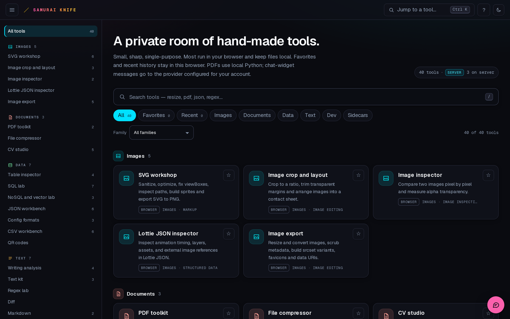
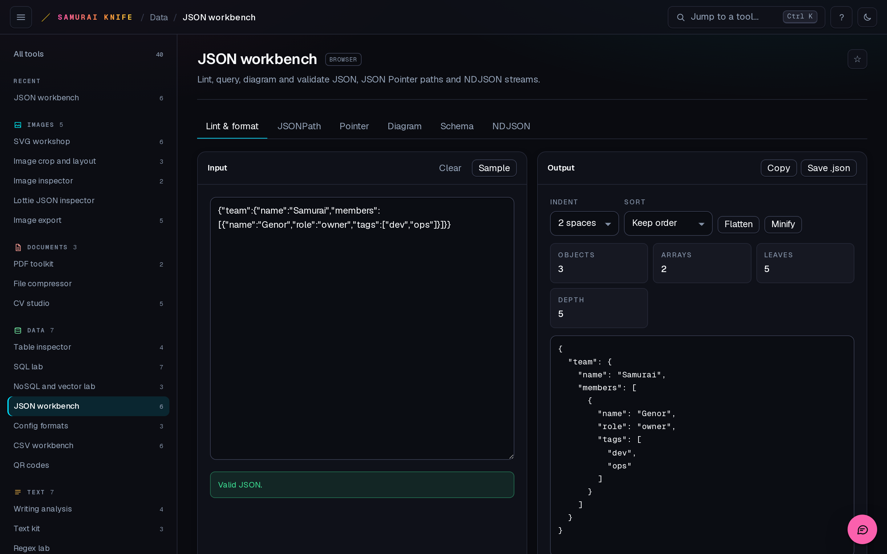
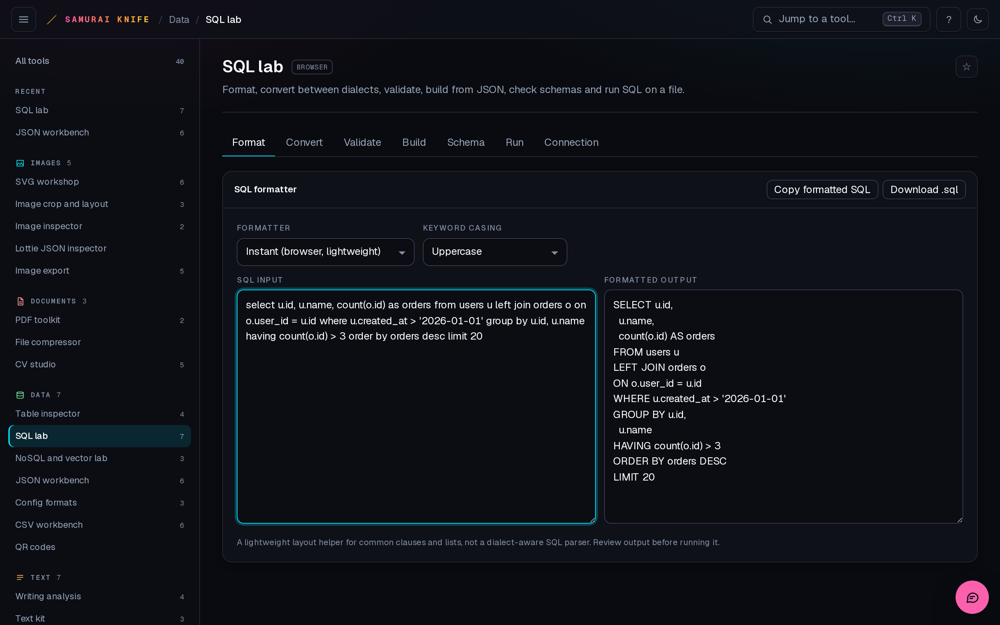
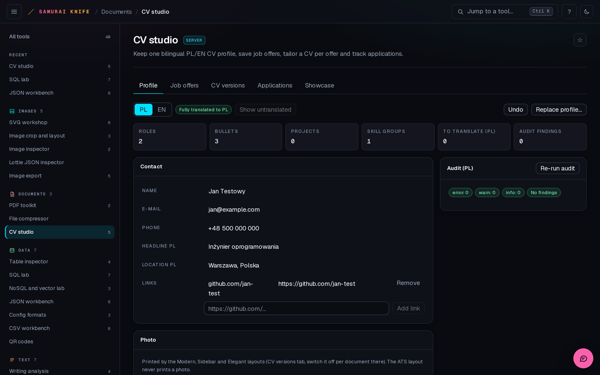
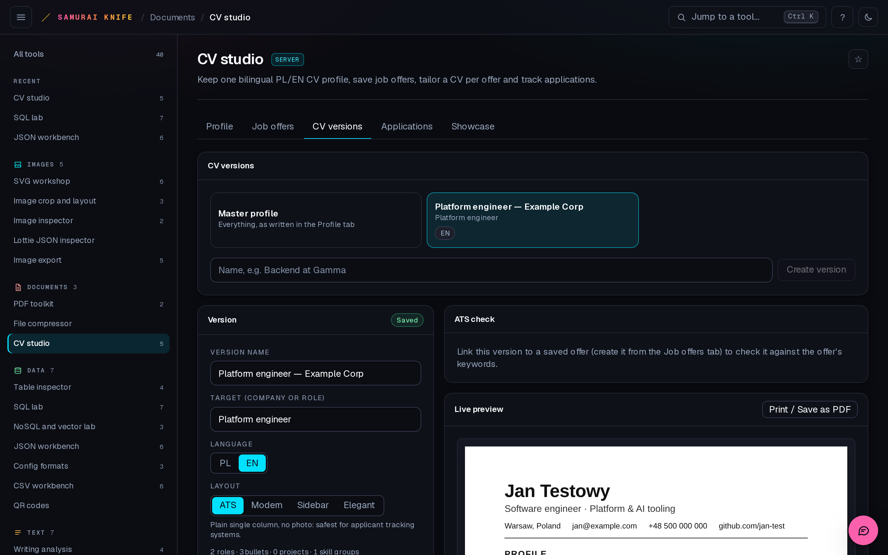
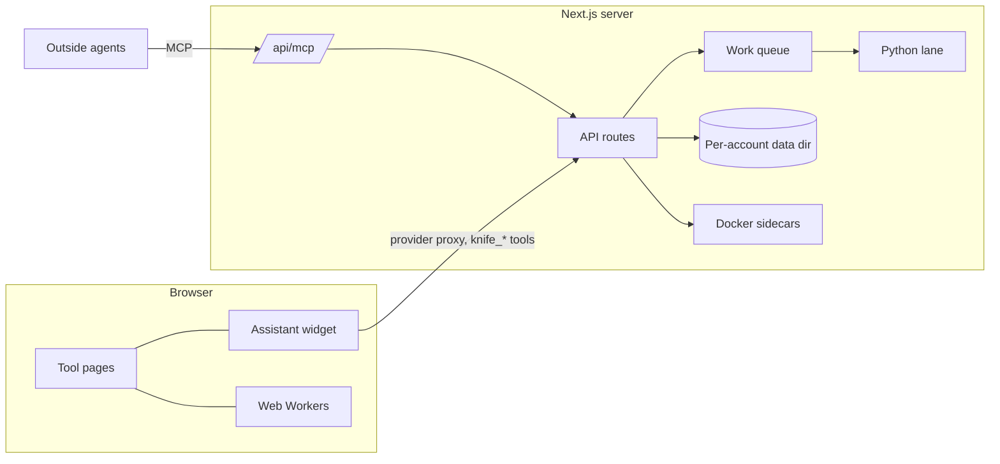

# Smart Knife

**A self-hosted, browser-first toolbox with an AI assistant that can actually use it.**

One launcher, 41 hand-made tools (31 suites with 107 tabs, plus 10 standalone), a chat assistant that drives the live
page, and an MCP endpoint so outside agents (Claude Code, Cursor, OpenClaw…) can use the same tools and steer the
screen you have open. No telemetry, no registration, no cloud: it runs on your own machine, and most tools never send a
byte off the page.



| | |
| --- | --- |
|  |  |
|  |  |

## What's inside

**Everyday tools**, grouped by the job you're doing rather than by file type:

- **Data**: JSON workbench (lint, JSONPath, Pointer, diagram, schema, NDJSON), CSV workbench, YAML/INI/XML, table inspector, QR codes
- **Databases**: SQL lab (format, transpile between dialects, validate, build from JSON, schema checks, run SQLite in the browser) and a NoSQL/vector lab (MongoDB, Chroma, Redis query builders with docs-derived validation)
- **Documents**: PDF toolkit (merge, split, compress, protect, an in-browser editor, OCR in English and Polish, searchable-PDF export), file compressor
- **Images**: export and resize, metadata scrubbing, responsive sets and favicons, crop and contact sheets, pixel compare, an SVG workshop, a Lottie inspector
- **Dev and web**: JWT and passwords, IDs and hashes, dates and time zones, cron and RRULE explainer, URL/IDN, colour and contrast, HTTP headers/CSP/cURL, CSS grid, type scales, effects, robots.txt and sitemaps, HTML accessibility audit, semver and lockfiles, stack traces
- **Text**: regex lab, diff, text kit, Markdown, writing analysis, Unicode and encoding inspector

**CV studio**: one bilingual (PL/EN) CV profile, saved job offers fetched from job boards, a tailored CV version per offer
with an ATS check, an application tracker, and a showcase builder that drafts project entries from GitHub repos.
Prints to PDF or exports DOCX.

**Database course** (Learn, optional sidecar): learn SQL and PostGIS by doing. 46 short lessons, from `SELECT` to
window functions, `EXPLAIN` and catchment analysis, each checked against a real PostgreSQL + PostGIS database the app
runs for you, with progressive hints and interview drills. See [docs/LEARN.md](docs/LEARN.md).

**Office documents** (optional sidecar): create and edit Word, Excel and PowerPoint files in a self-hosted editor that
the app installs, starts and idles down by itself through Docker Compose. A small editor plugin lets the assistant edit
the document you have open, live.

**ArtCraft apps** (optional sidecar): PhotoCraft, VectorCraft, FilmCraft, LightCraft, EffectCraft, DesignCraft and
PdfCraft, seven open-source (MIT OR Apache-2.0) creative apps by [storytold](https://github.com/storytold) that run
entirely in the browser as WebAssembly. A small read-only nginx container serves their pinned, hash-checked release
builds on an origin of their own; each app is a tab of one suite. See [docs/SIDECARS.md](docs/SIDECARS.md) "ArtCraft".

## The AI layer

- **Built-in assistant.** A chat widget that stays mounted across navigation. The agent loop runs in the browser:
  UI tools (`open_tool`, `page_snapshot`, `fill_field`, `click`, `read_text`, `wait_for`, `upload_file`…) act on the live
  DOM, and deterministic `knife_*` tools run on the server. Bring any OpenAI-compatible endpoint; the key stays on the
  server.
- **Guardrails, not vibes.** Trust modes (All / Most / Risky / None) gate acting calls, destructive actions on your input
  are confirmed one by one, and the agent never fabricates your files: it opens the tool and waits for you. Tool outputs
  chain between tools by reference (`f1`, `f2`…), never as base64 pasted through the model.
- **MCP endpoint.** `POST /api/mcp` (stateless Streamable HTTP) exposes 65 deterministic tools: CV studio, SQL/NoSQL,
  office documents, a course tutor and text utilities. Two MCP-only tools let an outside agent see which pages you have open and bring your
  visible tab to its result, with a short note on screen. Open pages refresh by themselves when an agent changes data,
  with Undo. See [docs/MCP.md](docs/MCP.md).

## Engineering highlights

- **Registry-driven.** `src/lib/registry.ts` is the single source of truth for every tool: the launcher, search, command
  palette, routing, metadata and static params all derive from it. Slugs are permanent; retired ones 308-redirect to
  their new suite tab.
- **Browser first, then a lane.** Heavy browser work moves to a typed Web Worker pool (queue, cancel, timeout, crash
  recovery). Work that needs a real library (PDF, OCR, sqlglot) goes to one-shot Python scripts behind a bounded work
  queue: concurrency per lane, backpressure as `503 + Retry-After`, and client aborts kill the process group.
- **Security model.** Two modes (`KNIFE_AUTH_MODE`): `private` (default) binds to loopback or a Tailscale address only
  (it refuses a wildcard bind); `public` runs behind a reverse proxy with registration, verified email, server-side
  sessions and admin/user roles ([docs/ACCOUNTS.md](docs/ACCOUNTS.md)). Every route
  checks Host, and every mutating route also checks Origin and accepts JSON bodies only, so cross-site "simple" requests
  never get through. The job-offer fetcher blocks private, loopback, link-local and CGNAT targets, including after
  redirects. Provider keys never reach the browser.
- **Tested like a product.** 38 unit test files and 51 Playwright end-to-end suites: every tool and tab on desktop and at
  390 px, hydration across locales and time zones, the assistant against a scripted mock provider, real
  Docker sidecars, and an MCP-only suite that drives the UI bridge without touching the page.



## Quick start

Requirements: Node.js 24, Python 3.12 (only for PDF/SQL server tools), and Docker (only for the office, course-database and ArtCraft sidecars).

```bash
git clone https://github.com/GenorTG/samurai-knife.git && cd samurai-knife
npm install
cp .env.example .env.local        # bind address, port, extra host names
npm run dev                       # http://127.0.0.1:3210
```

Python lane (the venv lives **outside** the repo, because Turbopack chokes on a symlinked interpreter inside the project):

```bash
python3.12 -m venv ../samurai-knife-py/venv
../samurai-knife-py/venv/bin/pip install -r server/py/requirements.txt
../samurai-knife-py/venv/bin/python server/py/setup_ocr.py   # Tesseract language data for searchable PDFs
```

### Configuration

All settings live in `.env.local` (gitignored); see [.env.example](.env.example).

| Variable | Default | Purpose |
| --- | --- | --- |
| `KNIFE_HOST` / `KNIFE_PORT` | `127.0.0.1` / `3210` | Bind address. Use your Tailscale IP to reach it from your other devices; `0.0.0.0` is refused. |
| `KNIFE_ALLOWED_HOSTS` | (empty) | Other names you open it by (machine name, LAN IP), for the Host/Origin guard and dev origins. |
| `KNIFE_DATA_DIR` | `~/.local/share/samurai-knife` | Accounts, CV data and documents. Never inside the repo. |
| `KNIFE_AUTH_MODE` | `private` | `public` = multi-user (registration, verified email, roles); see [docs/ACCOUNTS.md](docs/ACCOUNTS.md). |
| `KNIFE_PUBLIC_URL` / `KNIFE_TRUSTED_PROXIES` | (empty) | Public mode: absolute base for mail links (its host is allowed by the guard); proxy addresses whose `X-Forwarded-*` headers are trusted. |
| `KNIFE_MAIL_TRANSPORT`, `KNIFE_SMTP_*` | `outbox` (private) / `smtp` (public) | Account mail: SMTP, or `.eml` files in `$KNIFE_DATA_DIR/mail-outbox/`. |
| `KNIFE_PYTHON` | `../samurai-knife-py/venv/bin/python` | Interpreter for the Python lane. |
| `KNIFE_PY_LIGHT` / `KNIFE_PY_HEAVY` | `4` / `1` | Work-queue concurrency per lane. |

### Accounts

In private mode (the default) there is no sign-up route: accounts are created from the CLI only, and each keeps its own
model provider. Public mode adds self-registration with a verified email (contract: [docs/ACCOUNTS.md](docs/ACCOUNTS.md)).

```bash
npm run accounts -- list
npm run accounts -- add alice --name "Alice" --password-prompt
npm run accounts -- set-provider alice --base-url https://openrouter.ai/api/v1 --model openai/gpt-4o-mini --key-env OPENROUTER_API_KEY
```

In private mode the default account has no password: the network bind is the access boundary, so keep it on loopback
or a private tailnet. Public mode never falls back to it.

```bash
npm run accounts -- set-email alice alice@example.com    # owner-vouched (verified)
npm run accounts -- set-role alice admin                 # admin | user
npm run accounts -- set-status alice disabled            # active | disabled
```

## Development

```bash
npx tsc --noEmit && npm run lint                 # typecheck + lint
node tests/mock_provider.mjs 3299                # scripted model for assistant tests (key: mock-key)
python3 tests/run_all.py --only tsc,lint,unit,smoke,hydration
```

The suites start their own throwaway server (separate worktree, temp data dir, free port), so they never touch a
running instance. Details in [docs/TESTING.md](docs/TESTING.md).

**Adding a tool:** add an entry to `TOOLS` in `src/lib/registry.ts`, write the component in `src/tools/`, and register
it in `src/tools/registry-client.tsx`. Nothing else is wired by hand.

## Docs

- [docs/ARCHITECTURE.md](docs/ARCHITECTURE.md): layout, rules and hard-won gotchas
- [docs/MCP.md](docs/MCP.md): using the app from outside agents
- [docs/CV-STUDIO.md](docs/CV-STUDIO.md): the CV studio contract
- [docs/SIDECARS.md](docs/SIDECARS.md): Docker sidecars, the live office plugin and the ArtCraft apps
- [docs/LEARN.md](docs/LEARN.md): the Database course (lessons, seed, learner sandbox)
- [docs/SUITES.md](docs/SUITES.md): how 100 small tools became 30 suites
- [docs/TESTING.md](docs/TESTING.md): every suite and how to run it

## Stack

Next.js 16 (App Router, Turbopack) · React 19 · TypeScript · Tailwind CSS 4 · Zod · MCP TypeScript SDK · sql.js ·
pdf.js / pdf-lib · tesseract.js · Python 3.12 (pypdf, OCRmyPDF, sqlglot, python-docx) · Playwright · Docker Compose

## License

[PolyForm Noncommercial 1.0.0](LICENSE.md): free for personal use, study, research, hobby projects and noncommercial
organizations. Commercial use, including use inside a company, needs a separate license: open an issue or contact the
author.
